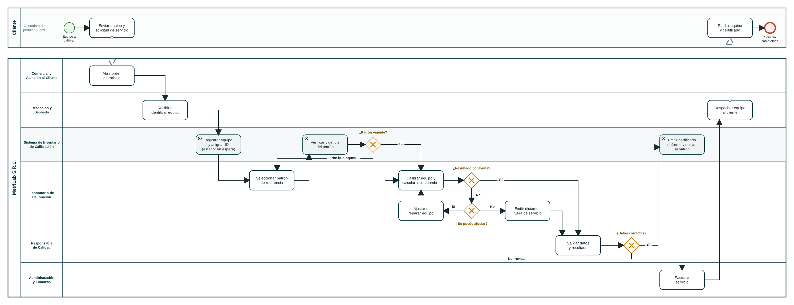

# Proceso de calibración de un equipo — BPMN

## Participantes

- **Pool Cliente:** operadora de petróleo y gas que envía el equipo y recibe el certificado.
- **Pool MetriLab S.R.L.**, con un carril (*lane*) por área del organigrama de la Entrega N.º 3:
  Comercial y Atención al Cliente, Recepción y Depósito, Laboratorio de Calibración,
  Responsable de Calidad y Administración y Finanzas.
- **Carril Sistema de Inventario de Calibración:** las tareas automatizadas por el software
  (marcadas con el ícono de tarea de servicio).

## Flujo estándar

1. El cliente envía el equipo y la solicitud de servicio (flujo de mensaje entre pools).
2. Comercial abre la orden de trabajo.
3. Recepción y Depósito recibe e identifica el equipo.
4. El sistema registra el equipo, le asigna un identificador único y lo deja en estado *en espera* (HU-01).
5. El Laboratorio selecciona el patrón de referencia y el sistema verifica su vigencia (HU-02).
6. El Laboratorio calibra el equipo y calcula la incertidumbre según la GUM.
7. El Responsable de Calidad valida los datos y el resultado.
8. El sistema emite el certificado vinculado al patrón utilizado y actualiza el estado (HU-03).
9. Administración factura el servicio y Recepción despacha el equipo al cliente.

## Compuertas de decisión (excepciones)

| Compuerta | Si la respuesta es No |
|---|---|
| ¿Patrón vigente? | El sistema bloquea el patrón y el técnico debe seleccionar otro. Es el control que hoy depende del criterio individual. |
| ¿Resultado conforme? | Se evalúa si el equipo se puede ajustar. |
| ¿Se puede ajustar? | Si se puede, se ajusta o repara y se vuelve a calibrar. Si no, se emite un dictamen de fuera de servicio, que también pasa por Calidad. |
| ¿Datos correctos? | Calidad devuelve el servicio al Laboratorio para revisar la calibración antes de emitir el certificado. |

## Qué cambia con el sistema

Las tres tareas del carril del sistema reemplazan pasos que hoy son manuales: la carga repetida
de datos del equipo, la verificación de vencimientos de patrones y el armado del certificado con
su trazabilidad. Son exactamente las tres funciones planificadas en el Gantt de la Entrega N.º 2.
